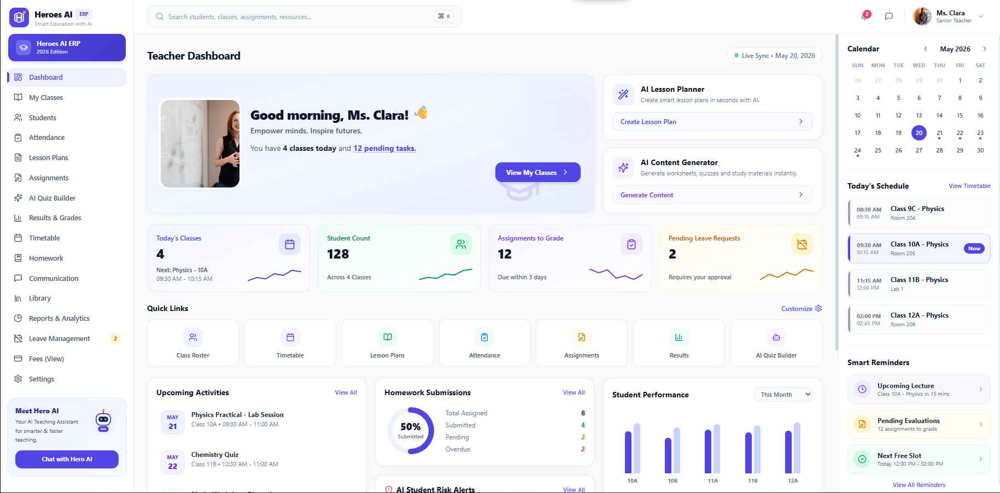

# Heroes AI ERP — Teacher Dashboard

Template frontend dasbor guru yang bisa dibuka tanpa login, backend, atau API key. Dibangun dengan React, TypeScript (TSX), Vite, Tailwind CSS, dan ikon Lucide.

**[Buka demo publik](https://laluarifta.github.io/Heroes-AI-ERP-Teacher-Dashboard/)**

## Preview



## Yang bisa dicoba

- Buka daftar kelas dan siswa, cari data, serta coba filter dan pengurutan tabel.
- Kelola contoh absensi, rencana pelajaran, tugas, kuis, nilai, dan pengajuan izin.
- Lihat kalender dan jadwal, ubah tema, atau atur tautan cepat.
- Coba alur Hero AI, penyusun rencana pelajaran, dan pembuat kuis. Fitur AI di sini berbasis aturan lokal, bukan layanan AI eksternal.

Data bawaan adalah contoh. Perubahan tersimpan di `localStorage` pada browser yang sedang dipakai dan tidak tersinkron ke pengguna lain. Untuk mengembalikan data contoh, gunakan menu **Settings**. Jangan masukkan data siswa sungguhan ke demo publik. Beberapa foto contoh dimuat dari Unsplash.

## Menjalankan secara lokal

Gunakan Node.js 22.12+ dan npm.

```sh
npm ci
npm run dev
```

Buka alamat lokal yang dicetak Vite. Untuk meninjau hasil produksi:

```sh
npm run build
npm run preview
```

## Struktur proyek

```text
.github/workflows/pages.yml       Build dan deploy ke GitHub Pages
index.html                       Halaman masuk Vite
src/
  main.tsx                       Bootstrap React
  features/teacher-dashboard/    Dashboard, konfigurasi, dan data contoh
    components/                  Tabel, elemen visual, dan dialog AI
  styles/                        Tailwind dan gaya global
docs/images/                      Gambar preview untuk README
```

## Menerbitkan salinan sendiri

Buat salinan repo lewat **Use this template**, lalu buka **Settings → Pages** dan pilih **GitHub Actions** pada pengaturan **Source**. Jalankan workflow **Deploy to GitHub Pages** dari tab **Actions**, atau push ke branch `main`. Vite menghasilkan aset relatif agar hasil build berfungsi di subdirektori repo GitHub Pages. Untuk hosting statis lain, publikasikan isi `dist/`.

Untuk kustomisasi, ubah data awal di `src/features/teacher-dashboard/demo-data.ts`, tema dan menu di `dashboard-config.ts`, serta judul dan deskripsi halaman di `index.html`.
